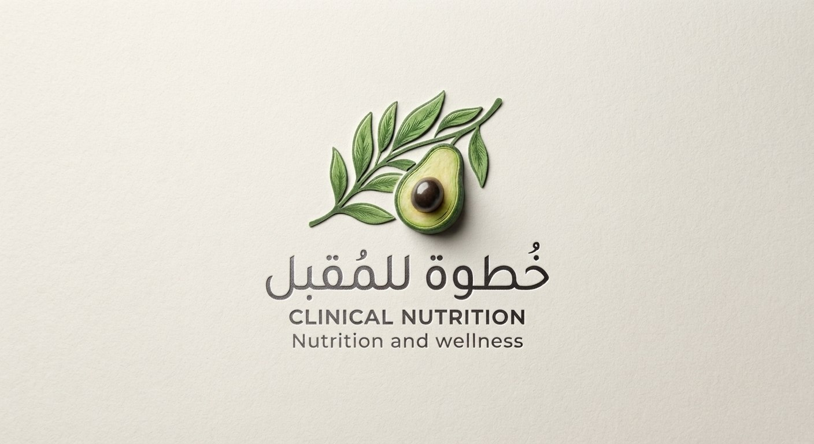

<!DOCTYPE html>
<html lang="ar" dir="rtl">
<head>
    <meta charset="UTF-8">
    <meta name="viewport" content="width=device-width, initial-scale=1.0">
    <title>خطوة للمُقبل | عيادة التغذية العلاجية - أخصائية التغذية إسراء المقبل</title>
    
    <!-- Google Fonts -->
    <link rel="preconnect" href="https://fonts.googleapis.com">
    <link rel="preconnect" href="https://fonts.gstatic.com" crossorigin>
    <link href="https://fonts.googleapis.com/css2?family=Tajawal:wght@300;400;500;700;800&family=Amiri:ital,wght@0,400;0,700;1,400&display=swap" rel="stylesheet">
    
    <!-- Font Awesome Icons -->
    <link rel="stylesheet" href="https://cdnjs.cloudflare.com/ajax/libs/font-awesome/6.4.0/css/all.min.css">

    
</head>
<body>

    <!-- Header / Navbar -->
    <header>
        

            <a href="#" class="logo-brand">
                
                

                    <h1>خطوة للمُقبل</h1>
                    عيادة التغذية العلاجية
                

            </a>

            <ul class="nav-links">
                <li><a href="#about">عن الأخصائية</a></li>
                <li><a href="#services">الخدمات العلاجية</a></li>
                <li><a href="#intake-form">استمارة المريض</a></li>
            </ul>

            <a href="https://wa.me/963932864065" class="btn-cta" target="_blank">
                <i class="fab font-awesome-icon fa-whatsapp"></i> احجز استشارتك
            </a>
        

    </header>

    <!-- Hero Section -->
    <section class="hero">
        

            

                🌿 خطوتك الأولى نحو صحة مستدامة
                <h2>لصحةٍ تدوم.. تجعل العافية في حياتك خطوة للمُقبل</h2>
                
مرحباً بك في منصتك الطبية المخصصة لبناء نمط حياة صحي متكامل، قائم على أحدث الأسس العلمية والتغذية العلاجية المحسوبة بدقة لملائمة احتياجات جسمك الفريدة.

                
                

                    <a href="#intake-form" class="btn-cta">
                        <i class="fas fa-notes-medical"></i> تعبئة استمارة التقييم
                    </a>
                    <a href="https://wa.me/963932864065" class="btn-secondary" target="_blank">
                        <i class="fab fa-whatsapp"></i> تواصل مباشر
                    </a>
                

            

            

                

                    
                

            

        

    </section>

    <!-- Bio / About Section -->
    <section id="about" class="section-padding bio-section">
        

            

                <h3>الأخصائية إسراء منصور المقبل</h3>
                
خبرة أكاديمية ورعاية طبية مخصصة

            

            

                

                    خريجة جامعة حمص وحاصلة على دبلوم الصحة العامة. أؤمن بأن التغذية ليست حرمانًا، بل هي أسلوب حياة يصنع الفارق في صحتك البدنية والنفسية. أعمل على تقديم برامج غذائية علاجية متكاملة مصممة خصيصاً لكل حالة.
                

                

                    

                        <i class="fas fa-user-graduate"></i>
                        

                            <h4>مؤهل أكاديمي</h4>
                            
جامعة حمص - دبلوم الصحة العامة

                        

                    

                    

                        <i class="fas fa-heartpulse"></i>
                        

                            <h4>تغذية علاجيّة</h4>
                            
خطط مخصصة لمختلف الحالات الصحية

                        

                    

                    

                        <i class="fas fa-sliders"></i>
                        

                            <h4>متابعة مستمرة</h4>
                            
دعم وتحليل دوري لضمان النتائج

                        

                    

                

            

        

    </section>

    <!-- Services Section -->
    <section id="services" class="section-padding">
        

            

                <h3>خدماتنا العلاجية</h3>
                
برامج مصممة بدقة علمية لترتقي بجودة حياتك

            

            

                <!-- الخدمة 1 -->
                

                    
<i class="fas fa-weight"></i>

                    <h4>إدارة الوزن الذكية</h4>
                    
أنظمة مخصصة لزيادة أو تخسيس الوزن بدون حرمان، تعتمد على حساب السعرات الحرارية والمغذيات الكبرى والصغرى حسب طبيعة جسمك.

                

                <!-- الخدمة 2 -->
                

                    
<i class="fas fa-notes-medical"></i>

                    <h4>التغذية العلاجية للأمراض</h4>
                    
خطط غذائية مساندة لمرضى السكري، ضغط الدم، تكيس المبيضين، القولون العصبي، وارتفاع كوليسترول الدم لتحسين التحاليل الطبية.

                

                <!-- الخدمة 3 -->
                

                    
<i class="fas fa-apple-whole"></i>

                    <h4>تغذية الحوامل والمرضعات</h4>
                    
برامج غذائية آمنة تلبي احتياجات الأم والجنين وضمان نمو صحي وتوفير العناصر الغذائية الأساسية طوال فترة الحمل والرضاعة.

                

                <!-- الخدمة 4 -->
                

                    
<i class="fas fa-child"></i>

                    <h4>تغذية الأطفال واليافعين</h4>
                    
معالجة انتقائية الطعام، وتأخر النمو، وزيادة الوزن عند الأطفال بطرق حببة ومحفزة تضمن بناء بنية جسدية سليمة.

                

            

        

    </section>

    <!-- Intake Form Section -->
    <section id="intake-form" class="section-padding form-section">
        

            

                <h3>استمارة التقييم التغذوي الأولية</h3>
                
قُم بتعبئة بياناتك ليتم تحليل حالتك وإعداد البرنامج الأنسب لك

            

            

                <form id="clinicForm" onsubmit="sendToWhatsApp(event)">
                    

                        

                            <label for="fullName">الاسم الكامل *</label>
                            <input type="text" id="fullName" required placeholder="مثال: أحمد خالد">
                        

                        

                            <label for="age">العمر *</label>
                            <input type="number" id="age" required placeholder="مثال: 25">
                        

                        

                            <label for="gender">الجنس *</label>
                            <select id="gender" required>
                                <option value="">اختر الجنس</option>
                                <option value="أنثى">أنثى</option>
                                <option value="ذكر">ذكر</option>
                            </select>
                        

                        

                            <label for="weight">الوزن الحالي (كغ) *</label>
                            <input type="number" id="weight" step="0.1" required placeholder="مثال: 70">
                        

                        

                            <label for="height">الطول (سم) *</label>
                            <input type="number" id="height" required placeholder="مثال: 165">
                        

                        

                            <label for="goal">الهدف الرئيسي *</label>
                            <select id="goal" required>
                                <option value="">اختر الهدف</option>
                                <option value="خسارة الوزن">خسارة الوزن</option>
                                <option value="زيادة الوزن والكتلة العضلية">زيادة الوزن والكتلة العضلية</option>
                                <option value="تغذية علاجية لمرض أو حالة صحية">تغذية علاجية لمرض أو حالة صحية</option>
                                <option value="تحسين نمط الحياة والصحة العامة">تحسين نمط الحياة والصحة العامة</option>
                            </select>
                        

                        

                            <label for="medicalHistory">هل تعاني من أي أمراض مزمنة أو مشاكل صحية؟</label>
                            <textarea id="medicalHistory" rows="3" placeholder="مثال: سكري، ضغط، قصور درقية، قولون عصبي... (اتركه فارغاً إذا لا يوجد)"></textarea>
                        

                        

                            <label for="notes">ملاحظات إضافية أو تفضيلات غذائية</label>
                            <textarea id="notes" rows="2" placeholder="أي معلومات تحب مشاركتها مع الأخصائية..."></textarea>
                        

                    

                    <button type="submit" class="btn-submit">
                        <i class="fab fa-whatsapp"></i> إرسال الاستمارة إلى الأخصائية مباشرة
                    </button>
                </form>
            

        

    </section>

    <!-- Footer -->
    <footer>
        

            

                

                    <h4>خطوة للمُقبل</h4>
                    
عيادة التغذية العلاجية إشراف أخصائية التغذية إسراء منصور المقبل. هدفنا أن نكون خطوتك الأولى والواثقة نحو عافية مستدامة.

                

                

                    <h5>تواصل معنا</h5>
                    
<i class="fas fa-phone"></i> 0932864065

                    
<i class="fab fa-whatsapp"></i> +963 932 864 065

                    
<i class="fas fa-location-dot"></i> حمص، سوريا

                

                

                    <h5>تابعنا على التواصل الاجتماعي</h5>
                    

                        <a href="https://instagram.com/Dt.Esraa_Almoqbel" target="_blank" title="Instagram"><i class="fab fa-instagram"></i></a>
                        <a href="https://facebook.com" target="_blank" title="Facebook"><i class="fab fa-facebook-f"></i></a>
                        <a href="https://wa.me/963932864065" target="_blank" title="WhatsApp"><i class="fab fa-whatsapp"></i></a>
                    

                

            

            

                
جميع الحقوق محفوظة © 2026 لـ عيادة خطوة للمُقبل - أخصائية التغذية إسراء المقبل

            

        

    </footer>

    <!-- JavaScript Script -->
    
</body>
</html>
